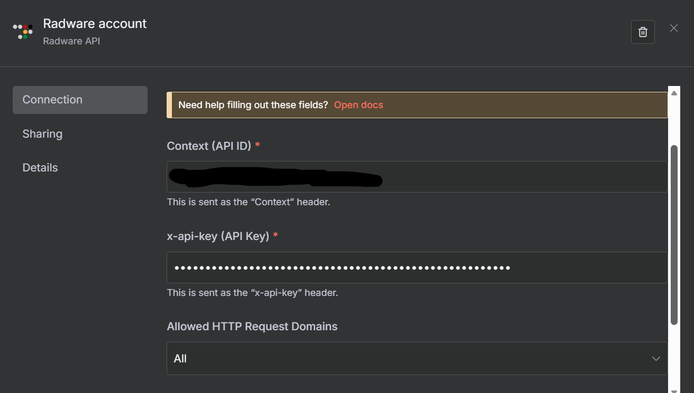
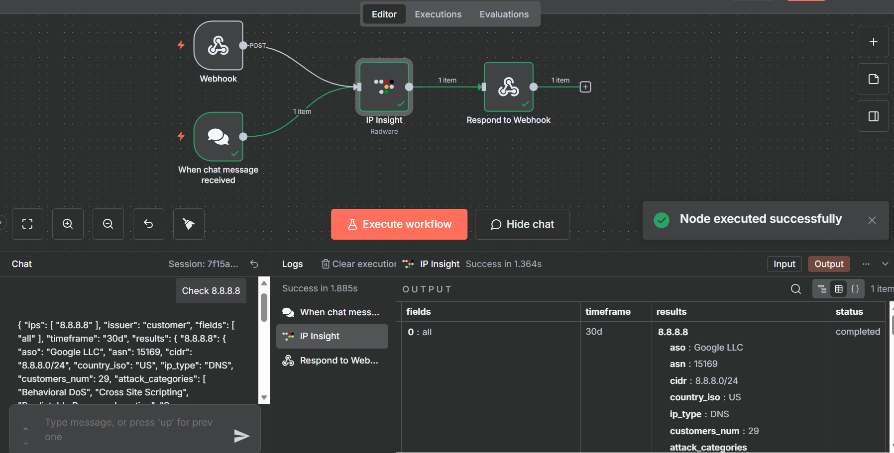

# @radware/n8n-nodes-radware

This is an n8n community node for interacting with Radware Threat Intelligence service.

It lets you use **Radware IP Insight** in your n8n workflows.

[n8n](https://n8n.io/) is a [fair-code licensed](https://docs.n8n.io/sustainable-use-license/) workflow automation platform.

[Installation](#installation)
[Operations](#operations)
[Credentials](#credentials)
[Compatibility](#compatibility)
[Usage](#usage)
[Resources](#resources)
[Version history](#version-history)

## Installation

Follow the [installation guide](https://docs.n8n.io/integrations/community-nodes/installation/) in the n8n community nodes documentation.

## Operations

### IP Insight

The Radware IP Insight node enables IP enrichment through Radware’s Threat Intelligence REST API endpoint.

It can process a single or multiple IPv4 addresses from different trigger types, extract IPs automatically from input data, or read them from uploaded files in various formats.

The multifunctional node is designed for secure parsing and supports retry logic for failed IP lookups.

*1)Supports auto-detect that automatically extracts IPs from input.*

* Automatically detects IPs or IP List from your input: free text, complete JSON objects, or delimiter-separated text (space, comma, newline, single quote, double quote)

*2)Body Input Mode: specific field, simple list, and raw JSON.*

* when “Auto-detect Input” turn off, you can select specific input format:

  a. Field – you can select specific or multiple fields

  b. Simple List – one IP per line or comma-separated or IPs with single quote and/or double quote

  c. raw JSON - IP's in JSON format

*3)File Upload support with ability to parse multiple documents formatted with JSON, TXT, CSV and LOG.*

*4)Provides customizable field projection for specific API response data.*

* Projection defines which fields to return in the API response.

* By default the projection was set to “all” but you can replace it according to your specific use-case.

* Supported fields include country_iso, ip_type, risk_score, actionable_insight and more.

*5)Includes configurable output modes to control response detail level.*

* Choose between “All” (includes IP which was failures to address) or “Valid Only” (successful IP Insight result only)

## Credentials

* This node uses **Radware IP Insight API credentials**.

* To authenticate, you must provide:

  * **Context (API ID)** — Your Radware Cloud tenant/account identifier

  * **x-api-key** — Your Radware API key

* Subscribe to configure Radware API keys here:

  [Radware Threat Intelligence Service](https://www.radware.com/products/threat-intelligence-service/)

## Compatibility

* Minimum n8n version: **compatible with 1.114.4 and recent n8n releases**

* Tested on: self-hosted n8n stable builds

## Usage

### Video walkthrough

For a demonstration of the Radware node and its features, see the [Radware n8n node video tutorial](https://www.youtube.com/watch?v=GlYqUOETvok).

### Example: Look up an IP address using IP Insight

This example uses an n8n chat message to request Radware threat intelligence for `8.8.8.8`.

#### 1. Configure credentials

1. Add a **Radware** node in the n8n workflow editor.
2. Under **Credential to connect with**, create or select a **Radware API** credential.
3. Enter **Context (API ID)** and **x-api-key (API Key)** from your Radware account, then save the credential. These values are sent in the `Context` and `x-api-key` request headers, respectively.
4. Do not share credential values in screenshots or exported workflows.

#### 2. Build and configure the workflow

1. Add **When chat message received** as the trigger and connect it to the **Radware** node.
2. In the Radware node, select **IP Insight** under **Operation**.
3. Select the saved **Radware account** credential and use these settings:

   | Setting | Example value |
   | --- | --- |
   | Operation | IP Insight |
   | HTTP Method | POST |
   | Read IPs From File | Off |
   | Auto-Detect Input | On |
   | Projection (List) | All |

4. To run the example, enter `Check 8.8.8.8` in the chat and send it. With **Auto-Detect Input** enabled, the node extracts the IP address from the incoming message.
5. Inspect the **IP Insight** node output after execution. The screenshot below shows a successful run. It also contains a **Respond to Webhook** node, which is optional for this chat-triggered IP Insight example; use that node when building a webhook-triggered workflow that needs an HTTP response.

#### 3. Interpret the result

For the example IP `8.8.8.8`, the successful execution screenshot shows a `completed` status and a `results` entry keyed by the queried IP address. Example response fields include:

| Field | Meaning | Value shown in example |
| --- | --- | --- |
| `aso` | Autonomous system organization | `Google LLC` |
| `asn` | Autonomous system number | `15169` |
| `cidr` | Network range | `8.8.8.0/24` |
| `country_iso` | Country code | `US` |
| `ip_type` | IP classification | `DNS` |
| `customers_num` | Customer count reported by the API | `29` |
| `attack_categories` | Categories of observed attack activity | List returned by the API |

The screenshot also shows `fields: ["all"]` and `timeframe: "30d"`. Available fields and values depend on the API response and selected settings. Results for a given IP may change over time.

For other input formats, see **Operations** above: the node also supports explicit field/list/JSON input, multiple IP addresses, file input, and configurable projections.

## Resources

[n8n community nodes documentation](https://docs.n8n.io/integrations/#community-nodes)

## Version history

- **0.1.9** — Package version in the current repository at the time of this documentation update. For earlier release details, consult the [GitHub tags and releases](https://github.com/Radware/n8n-nodes-radware/tags).

## License

* MIT
